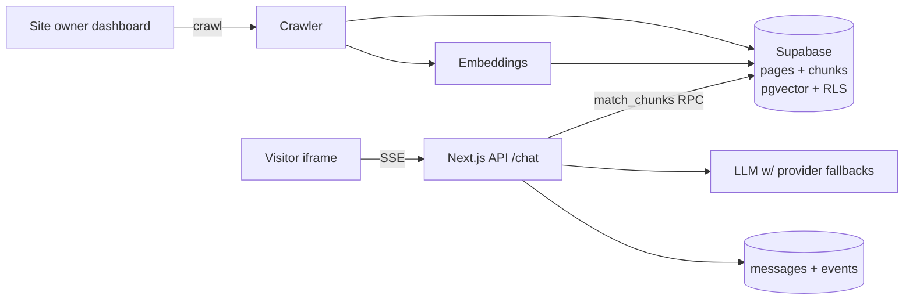

# ChatFlow — AI Support Agent

| | |
|---|---|
| **Stack** | Next.js 14 + TypeScript · Supabase (Postgres + pgvector + RLS) · OpenAI API · Groq/OpenRouter fallbacks |
| **Deploy** | Vercel (app) + Supabase (data) |
| **Live demo** | _link here_ |
| **Owner** | Omar Yasser |

An embeddable AI support widget: point it at a website, it crawls the pages,
generates embeddings, and answers visitor questions from those pages with **RAG** —
streamed token-by-token, cited with links back to the source pages.

The domain is exactly Chatbase's: fast customer-facing agents with clean DX and
reliable LLM response handling. Implementation choices were deliberately honest
about what breaks in production (rate limits, provider flakiness, stale indexes).

---

## How it works



1. **Crawl** — same-origin BFS, robots.txt-respecting, page-budget-capped; main-content
   extraction is DOM-free (scripts/nav/footer stripped), chunked into ~500-word blocks.
2. **Embed** — `text-embedding-3-small`, batched (32/request), stored as `vector(1536)`
   with an ivfflat cosine index; similarity runs through the `match_chunks` RPC so raw
   chunk rows never leave the database.
3. **Answer** — question → embedding → top-k chunks (threshold 0.3) → grounded system
   prompt → streaming answer over SSE with `[1] [2]` citations and source links.
4. **Deploy** — first-party script tag → iframe widget, so customer CSS can't break it.

## Features

- **RLS everywhere**: `sites`, `pages`, `chunks`, `conversations`, `messages`, `events`
  key off `owner_id`; the public site key can read *nothing but chunks via RPC*.
- **Rate limiting in two layers** — in-memory visitor bucket (burst 8 / 20-min) plus a
  durable per-site hourly cap computed at the database; exceed it and the widget gets an
  honest "reached its hourly limit" message, never a failed request.
- **Provider failover** — OpenAI → Groq → OpenRouter, with 429/5xx switching providers,
  transport-only retries with backoff. The chat never dies because one API hiccuped.
- **Analytics** — conversations, questions/7d, avg answer latency, and the
  *no-context ratio* (share of answers with no retrieved sources) surfaced on the dashboard.

## Quick start

```bash
git clone … && cd chatflow
cp .env.example .env   # fill in Supabase + OpenAI keys
npm install
npm run dev            # http://localhost:3000
```

1. Create a Supabase project and paste `supabase/migrations/0001_schema.sql`
   into the SQL editor (enable `pgvector`, it is in the script).
2. Register an account in `/dashboard`, add a site, hit **Crawl & index**.
3. Copy the embed snippet and paste it into any page — a chat bubble appears.

## API

| Route | Notes |
|---|---|
| `POST /api/chat` | `{ siteKey, visitorId, message, history[] }` → SSE stream + final `sources` frame |
| `POST /api/crawl` | dashboard-only; crawl → chunk → embed → upsert chunks idempotently |
| `GET /widget-loader.js` | the one-line embed script (public) |
| `/widget?k=…` | the chat UI served inside customer iframes |

## Design notes (interview defense)

- **Why Supabase for RAG?** pgvector turns retrieval into one RPC instead of a separate
  vector service. A single Postgres also gives RLS + logs under one roof.
- **Why an iframe widget?** Third-party CSS crashes kill support bots on real sites.
  The iframe isolates styles completely; only the bubble lives on the customer's page.
- **Chunks as mutable cache**: re-crawls delete+reinsert per page, so idempotency is a
  property of the pipeline, not of Stripe-style webhooks.
- **Streaming everywhere** — SSE from provider choice through to the iframe.

## Roadmap

- [ ] Talk-history UI per conversation (currently data is stored, UI shows stats)
- [ ] Streaming cite-rendering (`[1]` hyperlinked live)
- [ ] Switch to hybrid search (BM25 + vectors) once >1k chunks

MIT licensed.
